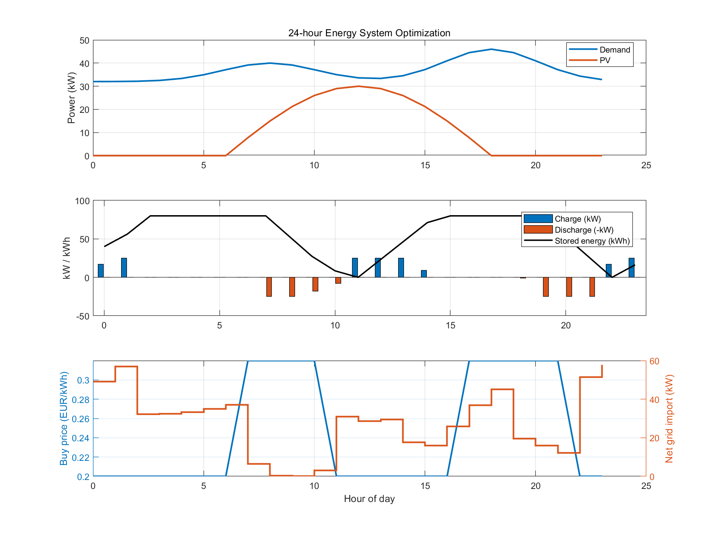

# Battery Energy Storage Optimization in MATLAB

## 1. Project Overview

This project develops a linear programming (LP) model for the optimal scheduling of a Battery Energy Storage System (BESS) integrated with photovoltaic (PV) generation and a time-varying electricity tariff.

The objective is to minimize the total electricity cost over a 24-hour scheduling horizon while satisfying power balance and battery operational constraints.

The optimization model is implemented in MATLAB using the Optimization Toolbox (`linprog`).

### Key Features

- 24-hour energy system optimization
- Photovoltaic generation integration
- Time-varying electricity prices
- Optimal battery charging and discharging
- Battery state-of-energy tracking
- Electricity cost comparison
- Visualization of optimization results

## 2. Energy System Configuration

The modeled energy system consists of:

- Building electricity demand
- Solar photovoltaic generation
- Battery energy storage
- Grid electricity import and export

### Battery Parameters

| Parameter | Value | Unit |
|---|---:|---|
| Battery capacity | 80 | kWh |
| Maximum charging power | 25 | kW |
| Maximum discharging power | 25 | kW |
| Charging efficiency | 95 | % |
| Discharging efficiency | 95 | % |
| Initial stored energy | 40 | kWh |
| Final stored energy | 40 | kWh |
| Scheduling horizon | 24 | hours |
| Time resolution | 1 | hour |

All input profiles are synthetic and are intended for model demonstration.

## 3. Mathematical Formulation

### Objective Function

The objective is to minimize the net electricity cost:

$$
\min \sum_{t=1}^{T} \left(c_t^{buy} P_t^{buy} - c_t^{sell} P_t^{sell}\right)\Delta t
$$

where:

- $c_t^{buy}$: electricity purchase price
- $c_t^{sell}$: electricity export price
- $P_t^{buy}$: grid import power
- $P_t^{sell}$: grid export power
- $\Delta t$: time-step duration

### Power Balance

$$
P_t^{buy}+P_t^{PV}+P_t^{dis}
=
P_t^{load}+P_t^{ch}+P_t^{sell}
$$

### Battery Energy Dynamics

$$
E_{t+1}
=
E_t+\eta_{ch}P_t^{ch}\Delta t
-\frac{P_t^{dis}\Delta t}{\eta_{dis}}
$$

### Battery Capacity Constraints

$$
0 \leq E_t \leq E_{max}
$$

### Charging and Discharging Limits

$$
0 \leq P_t^{ch} \leq P_{ch,max}
$$

$$
0 \leq P_t^{dis} \leq P_{dis,max}
$$

The initial and final battery energy levels are fixed at 40 kWh.

## 4. Optimization Method

The optimization problem is formulated as a linear program and solved using MATLAB's `linprog` function.

The decision variables include:

- Grid electricity import
- Grid electricity export
- Battery charging power
- Battery discharging power
- Battery stored energy

The model assumes perfect knowledge of electricity demand, PV generation, and electricity prices throughout the scheduling horizon.

## 5. Simulation Results

The optimized battery dispatch reduces the simulated daily electricity cost compared with the baseline scenario without battery operation.

| Performance Metric | Result |
|---|---:|
| Baseline electricity cost | EUR 166.27 |
| Optimized electricity cost | EUR 151.31 |
| Daily cost savings | EUR 14.96 |
| Cost reduction | 9.0% |

### Optimization Visualization



The figure illustrates:

1. Electricity demand and photovoltaic generation.
2. Optimized battery charging, discharging, and stored energy.
3. Dynamic electricity prices and net grid imports.

The battery generally charges during lower-price periods and discharges during higher-price periods, reducing electricity purchasing costs.

## 6. Model Validation

The following numerical checks were performed on the optimization results:

| Validation Check | Result |
|---|---|
| Optimization solver | Successful |
| Simultaneous charging/discharging periods | 0 |
| Maximum energy balance error | 7.1054e-15 |
| Battery energy range | 0–80 kWh |
| Maximum charging power | 25 kW |
| Maximum discharging power | 25 kW |

These checks confirm that the computed solution satisfies the tested constraints within numerical tolerance.

Simultaneous charging and discharging are not explicitly prohibited by binary decision variables in the current LP formulation.

## 7. Requirements

- MATLAB
- MATLAB Optimization Toolbox

## 8. How to Run

1. Clone or download this repository.
2. Open MATLAB.
3. Navigate to the project directory.
4. Open `bess_optimization.m`.
5. Click **Run**, or execute:

```matlab
bess_optimization
```

The script prints electricity cost results and generates visualization plots.

## 9. Model Assumptions and Limitations

- Synthetic demand, PV, and electricity price profiles
- Perfect foresight over the optimization horizon
- One-hour temporal resolution
- No battery degradation costs
- No electricity taxes or additional grid fees
- No detailed distribution network constraints
- No explicit binary charging/discharging exclusivity constraints
- No minimum battery state-of-charge reserve

The reported cost reduction is specific to the simulated scenario and should not be interpreted as a general real-world performance guarantee.

## 10. Future Work

Potential extensions include:

- Integration of historical German day-ahead electricity prices
- Battery degradation cost modeling
- Mixed-integer linear programming (MILP)
- Minimum state-of-charge constraints
- Sensitivity analysis of battery capacity and efficiency
- Comparison of different electricity tariff structures
- Rolling-horizon optimization under forecast uncertainty

## 11. Project Scope

This project demonstrates the application of mathematical optimization to energy storage scheduling and electricity cost minimization.

It provides a foundation for further research in energy system optimization, flexibility management, and battery energy storage operation.
